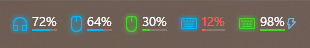

# Wireless Battery: edycja z kolorami marek

Pokazuje na pasku zadań Windows, ile baterii zostało w bezprzewodowej myszce, klawiaturze, słuchawkach i padzie.
Sprzęt znanych marek dostaje ikonę w kolorze producenta: **Razer** na zielono, **Logitech** na jasnoniebiesko,
**SteelSeries** na pomarańczowo, **Corsair** na żółto i tak dalej (15 marek, tabela niżej). Kolorowe urządzenia mają
delikatną poświatę i cienki pasek poziomu pod procentami. Pozostałe wyglądają zwyczajnie.



Wszystkie marki na ciemnym i jasnym pasku (u góry widżet na pasku, pod nim tryb ikon w zasobniku):


| Marka | Kolor | Rozpoznawana po |
| --- | --- | --- |
| Razer | zielony `#44D62C` | odbiorniki i Bluetooth Razera, słuchawki BlackShark / Barracuda, nazwa „Razer …” |
| Logitech | jasnoniebieski `#00B8FC` | Unifying, Bolt, Lightspeed, Bluetooth, nazwy „MX …”, „G915”, „K380” |
| SteelSeries | pomarańczowy `#FF5200` | odbiorniki SteelSeries, nazwy „Arctis”, „Aerox”, „Rival” |
| Corsair | żółty `#F5E41A` | odbiorniki Corsair (Slipstream), słuchawki przez HeadsetControl |
| HyperX | czerwony `#E31837` | odbiorniki HyperX, nazwa „HyperX …”, „Pulsefire” |
| ASUS ROG | czerwony `#FF0029` | odbiorniki ROG, nazwa „ROG …” |
| ZOWIE | czerwony `#E2231A` | odbiorniki ZOWIE |
| PlayStation | niebieski `#0070D1` | DualSense, DualShock 4, słuchawki INZONE |
| Xbox | zielony `#107C10` | pady i słuchawki Xbox |
| Samsung | niebieski `#1428A0` | Galaxy Buds, telefon Galaxy (Phone Link) |
| Apple | srebrny | AirPods, Magic Mouse / Keyboard / Trackpad |
| Jabra | żółty `#FFC800` | odbiornik Jabra Link, nazwa „Jabra …” |
| JBL | pomarańczowoczerwony `#FF3D00` | słuchawki JBL Quantum, nazwa „JBL …” |
| Cooler Master | fioletowy | myszy Cooler Master |
| Steam | niebieski `#1A9FFF` | Steam Controller |

Ciemne kolory (Xbox, PlayStation, Samsung) są na ciemnym pasku rozjaśnione, a jasne (żółte, srebrny) na jasnym
pasku przyciemnione, żeby zawsze było je widać. Słuchawki Sony z serii WH- / WF-, myszy HP i Microsoft Surface
mają ten sam numer producenta co PlayStation, HyperX i Xbox, ale nie dostają ich koloru.

To przeróbka programu [Wireless-Device-Battery-Monitor](https://github.com/krisgfx9/Wireless-Device-Battery-Monitor)
(autor: krisgfx9, wersja 1.0.5, licencja GPL-3). Cała obsługa urządzeń pochodzi z oryginału,
tutaj zmieniony jest tylko wygląd i kilka drobiazgów.

## Pobieranie i instalacja

1. Wejdź w **[Releases](../../releases/latest)** i pobierz `WirelessBattery-Setup-….exe`.
2. Uruchom i klikaj „Dalej”. Nie potrzeba uprawnień administratora ani żadnych innych programów.
   Instalator może od razu włączyć uruchamianie z Windows.

Wolisz bez instalatora? Pobierz `WirelessBattery-…-portable.zip`, rozpakuj gdziekolwiek i uruchom `WirelessBattery.exe`.

**Ostrzeżenie Windows („System Windows ochronił ten komputer”):** program nie ma płatnego podpisu cyfrowego,
więc Windows go nie zna. Kliknij *Więcej informacji → Uruchom mimo to*. Plik budują automaty GitHuba
z kodu widocznego w tym repo (zakładka *Actions*), nikt nie wgrywa go ręcznie.

## Obsługa

- Wskaźniki pojawiają się na pasku obok zegara i odświeżają co minutę, a od razu po podłączeniu urządzenia.
- **Kliknięcie** otwiera menu: lista urządzeń (kliknięcie ukrywa albo pokazuje urządzenie), odświeżanie,
  „Uruchamiaj z Windows”, zamknięcie.
- Czerwona liczba oznacza baterię na poziomie 15% albo niższym. Niebieski piorun oznacza ładowanie.
  Przygaszony wskaźnik to ostatni znany odczyt (urządzenie śpi).
- Najedź myszką, żeby zobaczyć pełne nazwy i stan.

## Co się różni od oryginału

- **Kolory producenta** dla 15 marek (tabela wyżej). Marka jest rozpoznawana kolejno po sterowniku, który znalazł
  urządzenie, po numerze producenta (USB/Bluetooth) i po nazwie. Kolory i reguły są w jednym pliku: `src/brands.cpp`.
  W trybie ikon w zasobniku kolor marki ma pasek pod liczbą.
- **Menu i podpowiedzi po polsku.**
- **Ładniejsze nazwy:** „DSV2 Pro” to „Razer DeathStalker V2 Pro”. Znika też przedrostek „LE-” z nazw słuchawek Bluetooth.
- **Poprawka Bluetooth:** słuchawki z dwoma rodzajami połączenia (klasyczny Bluetooth i LE Audio, np. Bose QC Ultra)
  nie znikają już z paska, gdy Windows wyliczy najpierw nieużywane połączenie.
- **`WirelessBattery.exe --demo`:** pokazuje przykładowe urządzenia Razer i Logitech, a `--demo=all` po jednym
  urządzeniu każdej marki (do zrzutów ekranu i sprawdzenia kolorów bez sprzętu). `--preview plik.bmp` rysuje
  wszystkie marki na ciemnym i jasnym pasku do pliku. `--list` wypisuje urządzenia razem z rozpoznaną marką.

## Obsługiwany sprzęt

Taki sam jak w oryginale: myszy, klawiatury i słuchawki Logitecha (Unifying, Bolt, Lightspeed, Bluetooth),
Razera (odbiorniki HyperSpeed, Bluetooth, słuchawki BlackShark), SteelSeries, Corsair, HyperX i wielu innych,
a do tego wszystko, co pokazuje baterię w *Ustawienia → Bluetooth i urządzenia*. Pełna lista jest
w [opisie oryginału](docs/ORIGINAL-README.md#supported-devices).

Logitech G HUB, Razer Synapse i inne programy producentów mogą działać równolegle, nie przeszkadzają sobie.

## Bezpieczeństwo

Program nie łączy się z internetem i niczego nie pobiera. Do urządzeń wysyła tylko zapytania „podaj stan baterii”.
W rejestrze zapisuje tylko swoje ustawienia (`HKCU\Software\WirelessBattery`) i, jeśli to włączysz, wpis
autostartu. Ta wersja używa tych samych ustawień co oryginał, więc nie instaluj obu naraz.

## Budowanie ze źródeł

Potrzebny jest [MinGW-w64](https://www.mingw-w64.org/), np. przenośny [WinLibs](https://winlibs.com/):

```
mingw32-make CXX=g++ WINDRES=windres
```

Instalator i wersję przenośną buduje `installer\build-installer.ps1` (wymaga [Inno Setup](https://jrsoftware.org/isinfo.php)).
Wypchnięcie tagu `v…` buduje i publikuje wydanie automatycznie (GitHub Actions).

## Licencja i autorzy

[GNU GPL v3.0 lub nowsza](LICENSE), tak jak oryginał. Oryginalny program i wszystkie protokoły urządzeń:
[krisgfx9 i współautorzy](https://github.com/krisgfx9/Wireless-Device-Battery-Monitor) (podziękowania dla źródeł
są w [opisie oryginału](docs/ORIGINAL-README.md#credits)). Do instalatora dołączony jest
[HeadsetControl](https://github.com/Sapd/HeadsetControl) (GPL-3).

Nazwy marek z tabeli to znaki towarowe ich właścicieli. Ten projekt nie jest z nimi związany, a kolory służą tylko
do rozpoznania sprzętu na pasku.
